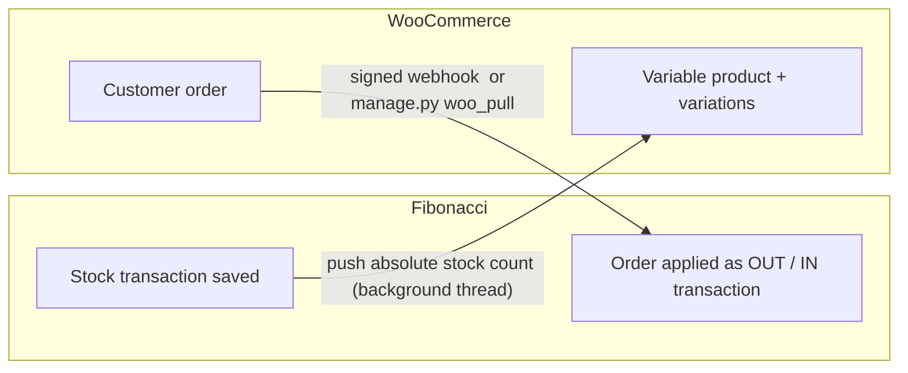
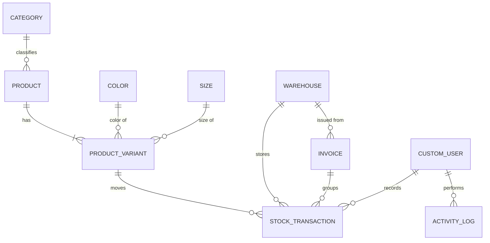

<div align="center">

# 🧵 Fibonacci

### Clothing Warehouse Management System

**A Persian (RTL) Django application for apparel businesses — color × size stock tracking, multi-line invoices with barcode scanning, Jalali-dated reports, Excel export, and two-way WooCommerce sync.**

<p>
  
  
  
  
  <a href="LICENSE"></a>
</p>

[Features](#-features) ·
[Quick Start](#-quick-start) ·
[Roles](#-roles--permissions) ·
[WooCommerce](#-woocommerce-integration) ·
[Data Model](#-data-model) ·
[Routes](#-routes) ·
[Tests](#-tests) ·
[Security](#-security--production-notes)

</div>

---

## 📖 Overview

**Fibonacci** is a web-based warehouse and inventory system built for clothing shops and apparel warehouses.
Instead of tracking one stock number per product, it tracks stock for every **product × color × size** combination (a *variant*), and records every change as an immutable **stock transaction**. Transactions can be grouped into printable **invoices** with buyer details, and the whole system can be kept in sync with a **WooCommerce** store.

The interface is fully **Persian (RTL)**, uses the **Asia/Tehran** time zone, and shows all dates in the **Jalali (Shamsi) calendar**.

## ✨ Features

### 📦 Products & variants
- Products with name, model SKU, brand, category, gender (men / women / boy / girl / unisex), season, material, base price, description, image, and active flag.
- Reusable **colors** (name, short code, HEX) and **sizes** (with display order).
- On product creation, select colors and sizes and fill a **color × size matrix** with initial quantities — variants are generated automatically and initial stock is recorded as *IN* transactions.
- Auto-generated variant SKUs in the form `MODELSKU-COLORCODE-SIZE`, optional barcode, optional per-variant price, and a per-variant **minimum-stock threshold** (default `3`).
- Product detail page with a color × size stock heat-matrix, row/column totals, stock value, and recent transactions.
- Search by name, model SKU, brand, variant SKU, or barcode; filter by category, gender and stock status (in stock / low / out); paginated lists.

### 🔄 Stock movements
- **Stock In / Stock Out** matrix forms: pick a product, enter quantities per color/size, submit.
- Stock-out is validated against available stock; multi-line operations run inside a **single database transaction** (all lines succeed or none do).
- Row-level locking (`select_for_update`) protects against concurrent over-selling.
- Transactions are **immutable** — saved records cannot be edited; corrections are made with compensating transactions.

### 🧾 Invoices (multi-line, barcode-ready)
- Dedicated **invoice screens** for stock-in and stock-out with live AJAX product/variant search.
- **Barcode scanner support** — exact barcode/SKU matching, with Persian/Arabic digits normalized automatically.
- Per-line unit price, up to 200 lines per invoice, atomic submission, and automatic invoice codes (`F<yymmdd>-XXXXX`).
- Stock-out invoices require the **buyer's name and a valid Iranian mobile number** (normalized to `09xxxxxxxxx`).
- Re-viewable and **printable** invoices with the store name in the header.

### 🏬 Warehouses
- Multiple warehouses with address and active/inactive state (warehouses with history can only be deactivated, not deleted).
- Warehouse list and detail pages show per-warehouse balances (total in, total out, net), variants held, and recent movements.

> **Stock model:** `ProductVariant.stock` is the global balance. Per-warehouse balances are *derived* from transactions (sum of IN − sum of OUT for that warehouse).

### 📊 Reports
| Report | What it shows |
|---|---|
| **Transactions** | Every in/out movement, filterable by text, date range, type and warehouse |
| **Stock** | Per-variant stock, status (in stock / low / out), unit price and stock value |
| **Invoices** | All invoices, searchable by code, buyer name or mobile number |
| **Sales** | Quantity and revenue grouped by **day**, **Jalali month**, or **product** |
| **Assets** | Inventory value by product and category (stock × base price) |
| **User activity** | Audit log of logins and actions with IP address *(admin only)* |

- Filters accept **Jalali or Gregorian** dates.
- Every report exports to **Excel (.xlsx)** or **CSV**, respecting the active filters.
- The `.xlsx` writer uses only the Python standard library (RTL sheets, frozen header row, text-safe cells) — no `openpyxl` needed.
- CSV output includes a UTF-8 BOM for Persian Excel compatibility and guards against formula injection.
- **Print mode** renders up to 5,000 filtered rows on one page with the store name and Jalali timestamp.

### ⚙️ Administration
- Manage colors, sizes, warehouses, categories, and users with role assignment.
- Edit or delete products from a dedicated management area (deletion requires password confirmation).
- Store name setting (printed on invoices and reports).
- Full **activity log**: logins, logouts, invoices, stock movements, product/category/settings/user changes.
- Standard Django Admin at `/admin/`.

### 🛒 WooCommerce integration
Two-way stock synchronization with a WooCommerce store — see [WooCommerce Integration](#-woocommerce-integration).
A WooCommerce-compatible **product import CSV** can also be exported from the product list.

## 🧰 Tech stack

| Layer | Technology |
|---|---|
| Backend | Python 3.12+, Django 6.1.2 |
| Database | MySQL (via `mysqlclient`) |
| Images | Pillow |
| Frontend | Django templates, vanilla JavaScript, custom CSS (RTL) |
| Localization | `fa-ir`, `Asia/Tehran`, built-in Jalali date utilities |
| Spreadsheets | Custom stdlib-only XLSX writer |
| Integrations | WooCommerce REST API + signed webhooks |

Dependencies (`requirements.txt`):

```text
Django==6.1.2
Pillow
mysqlclient
```

## 🚀 Quick start

### Prerequisites
- Python **3.12+**
- **MySQL** 8+ (or compatible MariaDB)
- Git
- Build tools for `mysqlclient` — on Debian/Ubuntu:
  ```bash
  sudo apt install build-essential pkg-config default-libmysqlclient-dev
  ```

### 1. Clone

```bash
git clone https://github.com/mmrezaqbi/Fibonacci.git
cd Fibonacci
```

### 2. Create a virtual environment

```bash
# macOS / Linux
python3 -m venv .venv
source .venv/bin/activate

# Windows (PowerShell)
python -m venv .venv
.venv\Scripts\Activate.ps1
```

### 3. Install dependencies

```bash
python -m pip install --upgrade pip
pip install -r requirements.txt
```

### 4. Create the database

```sql
CREATE DATABASE fibonacci CHARACTER SET utf8mb4 COLLATE utf8mb4_unicode_ci;
```

Then open `config/settings.py` and set the `DATABASES["default"]` values (`NAME`, `USER`, `PASSWORD`, `HOST`, `PORT`) for your own MySQL server.
Use credentials of your own — and see [Security & production notes](#-security--production-notes) for keeping them out of source control.

### 5. Migrate and create an admin

```bash
python manage.py migrate
python manage.py createsuperuser
```

Migrations are already committed, so `makemigrations` is not required.

### 6. Run

```bash
python manage.py runserver
```

| URL | Purpose |
|---|---|
| http://127.0.0.1:8000/ | Application (login required) |
| http://127.0.0.1:8000/admin/ | Django Admin |

### 7. First-time setup

Sign in with your superuser account, then (under **Settings**) add the basic data the workflow depends on:

1. **Warehouses** — at least one active warehouse.
2. **Colors** — name, short code (used in SKUs, e.g. `BLK`), and HEX value.
3. **Sizes** — name and display order.
4. **Store name** — printed on invoices and reports.
5. **Categories** — to organize products.

Then add your first product from **Products → New product**.

## 👥 Roles & permissions

Roles are stored as Django groups (created automatically when first needed) and defined in [`application/permissions.py`](application/permissions.py).

| Role | Who | Access |
|---|---|---|
| **Admin (مدیر)** | Django superuser | Everything: users, settings (colors, sizes, warehouses, store), WooCommerce, product edit/delete, activity report |
| **Keeper (انباردار)** | Member of group `انباردار` | Create products, register stock in/out, export the WooCommerce product CSV, plus all viewer access |
| **Viewer (مشاهده‌گر)** | Member of group `مشاهده‌گر` or no group | Browse products, warehouses and reports |

## 🛒 WooCommerce integration



**Fibonacci → WooCommerce**
- After every stock movement, the variant's current stock is pushed to WooCommerce as an **absolute number** (not a delta).
- Missing products are created as **draft variable products** (attributes `رنگ` / `سایز`), or linked to an existing product with the same SKU. Review and publish them in WooCommerce.
- A **Full sync** action creates/links every active product and sends all stock levels.
- Sync runs in a background thread and never blocks or breaks stock registration; failures are written to a sync log.

**WooCommerce → Fibonacci**
- Orders in `processing`, `on-hold` or `completed` status create **OUT** transactions in the configured default warehouse.
- Orders that become `cancelled`, `refunded` or `failed` create compensating **IN** transactions.
- Processing is **idempotent** (each order is tracked once) and orders created before sync was enabled are never deducted.

### Setup

1. In WooCommerce, create **REST API keys** with read/write permission.
2. In Fibonacci open **Settings → WooCommerce** (admin only) and enter the site URL, consumer key and consumer secret, a webhook secret, and the default warehouse; tick *enabled*.
3. Use **Test connection**, then **Full sync**.
4. *(Recommended)* In WooCommerce → Settings → Advanced → Webhooks, create webhooks for **Order created** and **Order updated** with delivery URL `https://<your-host>/woocommerce/webhook/` and the same secret. Requests are verified with HMAC-SHA256 (`X-WC-Webhook-Signature`).
5. *(Fallback / polling)* Schedule the pull command, e.g. with cron:

   ```bash
   */5 * * * * cd /path/to/Fibonacci && .venv/bin/python manage.py woo_pull
   ```

## 🧱 Data model



| Model | Purpose |
|---|---|
| `Category`, `Warehouse`, `Color`, `Size` | Reference data |
| `Product` | Model-level product info (name, SKU, brand, gender, season, base price, image) |
| `ProductVariant` | Unique product + color + size, with its own SKU, barcode, stock and minimum stock |
| `StockTransaction` | Immutable IN/OUT movement (quantity, warehouse, note, unit price, user, invoice) |
| `Invoice` | Invoice header: code, type, warehouse, buyer name/mobile, note |
| `ActivityLog` | Who did what, when, and from which IP |
| `StoreSettings` | Store name (single row) |
| `WooSettings`, `WooProductLink`, `WooVariantLink`, `WooOrder`, `WooLog` | WooCommerce connection, ID links, processed orders and sync log |
| `accounts.CustomUser`, `accounts.CountryCode` | Custom user with profile fields, phone country codes |

## 🗂️ Project structure

```text
Fibonacci/
├── accounts/                  # Custom user model, profile fields, auth admin
├── application/               # Core inventory app
│   ├── models.py              # Products, variants, transactions, invoices, Woo models
│   ├── views.py               # Dashboard, product list/detail/create, stock forms
│   ├── invoice.py             # Multi-line invoices + AJAX search APIs
│   ├── warehouses.py          # Warehouse list/detail (derived balances)
│   ├── categories.py          # Category management
│   ├── reports.py             # Reports, filters, print mode, CSV/XLSX export
│   ├── exports.py             # WooCommerce-format product CSV
│   ├── xlsx.py                # Dependency-free .xlsx writer
│   ├── permissions.py         # Roles and role_required decorator
│   ├── settings_pages.py      # Admin settings: colors, sizes, users, products
│   ├── woo_client.py          # WooCommerce REST client
│   ├── woo_sync.py            # Two-way stock/order synchronization
│   ├── woo_pages.py           # WooCommerce settings page + webhook endpoint
│   ├── jalali.py, dates.py    # Jalali conversion and date parsing
│   ├── templatetags/          # Jalali, money and navigation template tags
│   ├── management/commands/
│   │   └── woo_pull.py        # Scheduled order pull
│   ├── migrations/
│   └── tests.py
├── config/                    # Django settings, URLs, ASGI/WSGI
├── extensions/                # Shared Jalali/date helpers
├── templates/                 # HTML templates (reports, settings, invoices, …)
├── static/                    # css/base.css, js/base.js
├── media/                     # Uploaded product images and avatars
├── manage.py
├── requirements.txt
└── LICENSE
```

## 🧭 Routes

| Path | Description |
|---|---|
| `/` | Dashboard — active products, total stock, low-stock items, today's activity |
| `/products/` · `/products/new/` · `/products/<id>/` | List, create, detail |
| `/products/export/csv/` | WooCommerce-format product export |
| `/stock/in/` · `/stock/out/` | Matrix stock forms |
| `/stock/in/invoice/` · `/stock/out/invoice/` | Multi-line invoice screens |
| `/warehouses/` · `/warehouses/<id>/` | Warehouse overview and detail |
| `/categories/` | Category management |
| `/reports/transactions/` · `stock/` · `invoices/` · `sales/` · `assets/` · `activity/` | Reports (add `?export=xlsx`, `?export=csv` or `?print=1`) |
| `/reports/invoices/<id>/` | View / reprint an invoice |
| `/settings/…` | Colors, sizes, warehouses, users, products, store, WooCommerce *(admin)* |
| `/api/variants/search/` · `/api/products/search/` · `/api/product-variants/<id>/` · `/api/invoice/submit/` | JSON endpoints used by the invoice screens |
| `/woocommerce/webhook/` | WooCommerce webhook receiver |
| `/login/` · `/logout/` | Authentication |
| `/admin/` | Django Admin |

## 🧪 Tests

```bash
python manage.py test
```

The suite in `application/tests.py` covers buyer/phone normalization, money formatting, navigation highlighting, invoice creation and validation, invoice search, store settings permissions, sales/asset/activity reports, XLSX/CSV export validity, filter-aware exports, and print mode.

## 🔐 Security & production notes

The repository is configured for **local development**. Before deploying:

- **Move secrets out of `config/settings.py`.** The Django `SECRET_KEY` and the database credentials are currently hard-coded — load them from environment variables, and **rotate any credential that has already been committed**.
- Set `DEBUG = False` and replace `ALLOWED_HOSTS = ['*']` with your real hostnames.
- Serve over **HTTPS**; enable secure cookies, `CSRF_TRUSTED_ORIGINS` and security headers.
- Serve static files and media properly (e.g. `collectstatic` + a web server); Django's media route is for development only.
- Use a dedicated, least-privilege MySQL user instead of `root`.
- WooCommerce consumer keys/secrets are stored in the database — restrict database and admin access accordingly.
- User profiles include personal fields (phone, national code, address, …) — handle them according to your privacy requirements.
- Do not commit real data, uploaded files, or `.env` files.

See the [Django deployment checklist](https://docs.djangoproject.com/en/stable/howto/deployment/checklist/).

## 🛣️ Roadmap

- [ ] Environment-based settings (`.env`) and production configuration
- [ ] Per-warehouse stock balances stored natively (currently derived)
- [ ] Stock transfers between warehouses
- [ ] Expanded test coverage (accounts, WooCommerce sync, concurrency)
- [ ] CI pipeline (lint + tests) and Docker setup
- [ ] Screenshots / demo GIF

## 🤝 Contributing

1. Fork the repository and create a branch: `git checkout -b feature/your-feature`
2. Make your changes and add tests where appropriate.
3. Run `python manage.py test`.
4. Open a Pull Request describing the change.

For larger changes, please open an issue first to discuss the approach.

## 📄 License

Released under the **MIT License** — see [LICENSE](LICENSE).

## 👨‍💻 Author

**Mohamad Reza Qarebaqi** — [@mmrezaqbi](https://github.com/mmrezaqbi)

---

<div align="center">

Built with Django · Designed for clothing inventory workflows

⭐ If Fibonacci is useful to you, consider starring the repository.

</div>